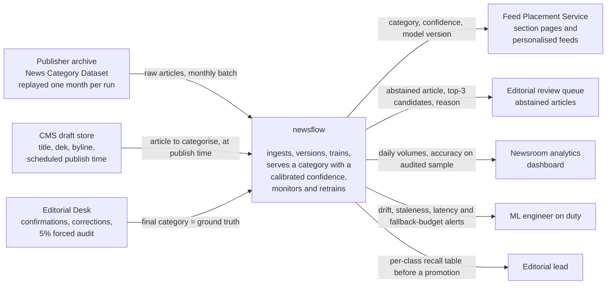
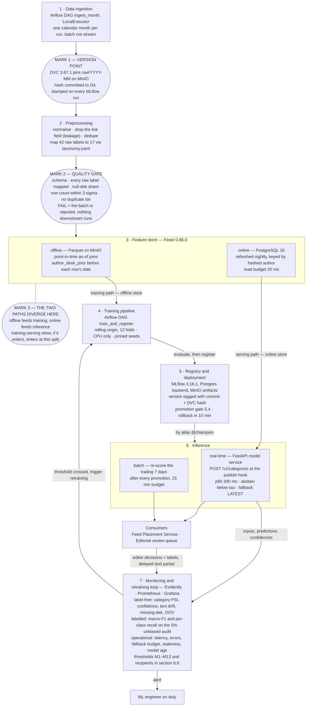
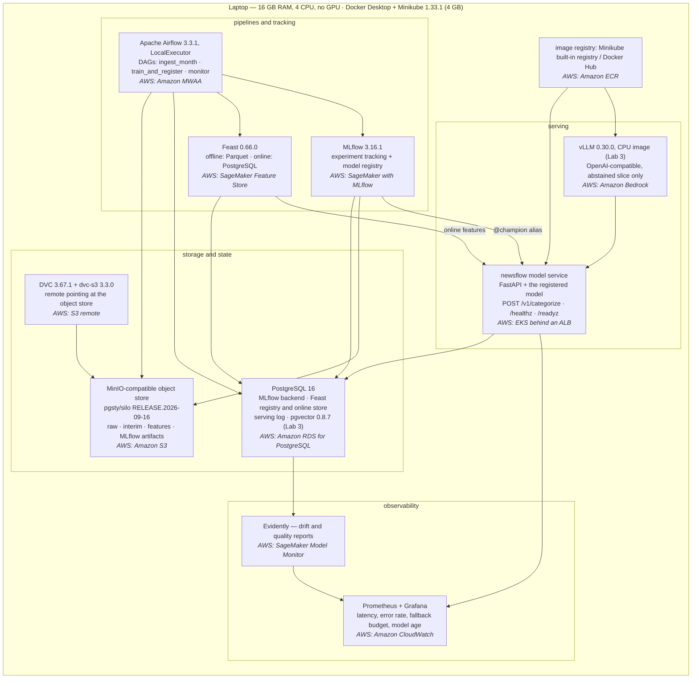

# newsflow — Design Document

**Project:** topic routing for an online news aggregator
**Use case variant:** Dynamic news classification (Appendix 1, variant 1)
**Author:** V. Moisieiev · KSE MLOps
**Status:** Lab 1 — design. No pipeline code exists yet.
**Template:** [eugeneyan/ml-design-docs](https://github.com/eugeneyan/ml-design-docs). Section numbers
are stable: later labs revise sections by number and never renumber them.

**Revision log**

| Lab | What changed |
| --- | --- |
| Lab 1 | First version. Sections 1–7.4 filled; 7.2 and 7.3 are placeholders. |

Every statement that is not yet verifiable is written as **Assumption:** with the number it is
assumed to be and how it will be checked. Nothing in this document is left empty.

---

## 1 Overview

An online news aggregator ingests roughly 2,000 articles a day from publisher feeds, and each one
has to be placed into exactly one of 17 section categories before it can appear on a section page or
in a reader's personalised feed. That assignment is made by hand today, which puts the editorial
desk between an article arriving and an article being visible, and the cost of that queue grows with
volume while the quality of it does not. `newsflow` is a service that reads an article's headline and
dek at publish time and returns a category with a calibrated confidence, so that articles above a
confidence threshold are placed automatically and only the uncertain remainder reaches an editor.
Because the topic mix of the news itself moves — the categories that dominated 2013 do not describe
2022 — the system is built to detect that movement, retrain on recent months, and prove a candidate
is better before it replaces the model in production. The outcome we are buying is editorial
capacity: at most 40 editor touches per 100 published articles instead of 100, with no increase in
wrong-section placements.

*This section is the anchor of the document and is not revised in later labs.*

---

## 2 Motivation

**Why a system and not a notebook.** A notebook can produce a classifier for the 42 labels in the
archive; it cannot hold the promise this product makes, which is that *every article published today*
gets a category *within the publishing flow* and that the quality of those categories does not quietly
decay. Three properties force a system: the predictions are consumed by another service
synchronously, the ground truth arrives later and from humans, and the input distribution changes
continuously. None of those three has anywhere to live in a notebook.

**Who consumes the predictions.**

| Consumer | Kind | How often | What it does with the prediction |
| --- | --- | --- | --- |
| Feed Placement Service | machine, synchronous | once per article at publish, ~2,000/day | writes the section on the article record; the article appears on that section page and enters the personalisation index |
| Editorial review queue | human, asynchronous | the abstained slice, ~40% of articles | an editor sees the top-3 candidates and confirms or overrides |
| Newsroom analytics dashboard | human, daily | 1 read/day | daily volumes per category, accuracy on the audited sample |

**How fresh the predictions must be.** The prediction is needed *at the moment of publication* — it
gates placement. A prediction that arrives an hour later is worth almost nothing, because the article
has already been placed in the default `LATEST` bucket and a human has already been paged. This is
why the serving path is online and not batch (section 6.3).

**What happens when they are wrong.** A wrong category is not symmetric with a missing one:

- *Wrong and auto-accepted.* The article is live on the wrong section page. Readers of that section
  see irrelevant content, the personalisation index learns a wrong association for that article's
  audience, and the correction has to happen after publication, which costs more editor time than
  tagging it would have. This is the expensive failure and it is what the confidence threshold exists
  to bound.
- *Wrong and abstained.* Costs nothing beyond one editor touch — the same touch as today. This
  asymmetry is why the system is allowed to abstain and why the business metric is editor touches
  rather than raw accuracy.
- *Service unavailable.* The Feed Placement Service falls back to `LATEST` and the article goes to the
  editorial queue. The product degrades to today's behaviour instead of blocking publication
  (section 4, availability row).

---

## 3 Success metrics

Three layers, kept apart. Each has a target or a stated assumption.

### 3.1 Business / decision metric

| Metric | Baseline today | Target | Measured how |
| --- | --- | --- | --- |
| **Editor touches per 100 published articles** (primary) | 100 | **≤ 40** within one quarter after launch | count of articles that enter the editorial review queue ÷ articles published, daily |
| Wrong-section corrections raised after publication, per 100 articles | **Assumption: 3.0** — manual tagging is not perfect either; measured from CMS correction events during the first month of shadow running | ≤ 3.0 (do not get worse) | CMS `correction` events joined to the serving log |
| Median time from article arrival to placement | **Assumption: 45 min**, dominated by queue wait; confirmed from CMS timestamps in Lab 2 | ≤ 5 min for the auto-accepted slice | CMS timestamps |

The primary metric is a **satisficing-and-optimising pair**: maximise auto-accept rate *subject to*
the correction rate not exceeding 3.0 per 100. Auto-accept rate is the optimisation metric; the
correction rate is the satisficing constraint.

### 3.2 Model metric

Evaluated on the 17 serving categories (section 5.2), on a held-out time period (section 5.4).

| Metric | Target | Why this one |
| --- | --- | --- |
| **macro-F1** | **≥ 0.70** | the head class is ~17% of rows; micro-F1 would let the model abandon the small categories and still look good |
| per-class recall, every category | **≥ 0.45**, no exceptions | a section page that never receives articles is a product outage for that section, invisible to any aggregate metric |
| expected calibration error (ECE) on top-1 probability | **≤ 0.05** | the auto-accept gate *is* a threshold on this number; an uncalibrated 0.9 makes the business metric meaningless |
| auto-accept rate at the operating threshold | ≥ 0.60 | the model-side mirror of the business metric |

**Assumption:** the Lab 2 baseline (TF-IDF → calibrated linear model) reaches **macro-F1 ≈ 0.62–0.68**
on the 2022 hold-out. This is an estimate from published results on this dataset at 42 labels
(typically 0.5–0.6 macro-F1) adjusted upward for the collapse to 17 categories. It is confirmed or
corrected by the first run in Lab 2, and section 7.2 records the real number.

### 3.3 System metric

| Metric | Target |
| --- | --- |
| **Freshness** — age of the deployed model's training data | p95 ≤ 35 days; retrain scheduled monthly |
| **Latency** — single-article `POST /v1/categorize` | **p95 ≤ 300 ms**, p99 ≤ 800 ms, measured server-side |
| **Throughput** | 2,000 articles/day sustained; **10 req/s** burst absorbed without queueing |
| **Availability** of the inference API | 99.5% monthly (≈ 3.6 h/month budget), fallback defined in section 4 |
| **Pipeline success rate** | ≥ 95% of scheduled monthly ingest+train runs succeed without manual intervention |

A design that lists only §3.2 is incomplete: §3.2 can improve while §3.1 gets worse (the model gets
better on the common categories and more confident on the rare ones it is wrong about), and §3.3 can
fail while both look perfect (the batch is stale and we are scoring last month's world).

---

## 4 Requirements and constraints

### 4.1 Functional requirements

| # | Requirement |
| --- | --- |
| F1 | **Categorise one article.** Input: `{article_id, headline, dek, byline, source_feed_id, scheduled_publish_ts}`. Caller: the CMS publish hook, synchronously. Returns: `{category, confidence, top3[], abstain, model_version, data_version, request_id}`. |
| F2 | **Abstain.** When the calibrated top-1 probability is below the operating threshold τ (initially **Assumption: τ = 0.70**, tuned in Lab 2 against the §3.1 constraint), `abstain = true` and the caller routes the article to the editorial queue. |
| F3 | **Accept ground truth.** Input: `{article_id, final_category, decided_by, decided_at}` from the Editorial Desk. Stored as the label stream; this is the only source of ground truth. |
| F4 | **Re-score a range.** After a model is promoted, re-score the trailing 7 days of articles as a batch so section pages are consistent with one model version. |
| F5 | **Ingest a period.** One command / one scheduled run ingests the next unconsumed calendar month, versions it, and fails loudly if it does not pass the quality gate. |
| F6 | **Train and register.** One command trains on a declared window, logs parameters, metrics, data version and commit to the tracking server, and registers the model with that lineage. |
| F7 | **Report quality.** Compute, on a schedule, drift and accuracy reports over the serving log and the audited sample, and emit the alerts of section 6.6. |
| F8 | **Explain for the editor** *(Lab 3)*. For an abstained article, return a short justification grounded in retrieved comparable articles and the editorial taxonomy definitions. |

### 4.2 Non-functional requirements

One row per category. Every row carries a number or an explicit assumption.

| Category | Requirement |
| --- | --- |
| **Freshness** | The serving model is trained on data no older than **35 days (p95)**. New raw data lands as one **calendar-month** partition; the daily feature view is at most **24 h** stale. The prediction itself is produced **synchronously**, so a prediction is never stale — only the model behind it can be. |
| **Latency and throughput** | **p95 ≤ 300 ms**, p99 ≤ 800 ms per article, server-side, measured at the API boundary. Sustained **2,000 articles/day**; burst **10 req/s**. Batch re-scoring of 7 days (~14,000 articles) completes in **≤ 15 min**. |
| **Availability and fallback** | **99.5%** monthly for `POST /v1/categorize`. On timeout (> 1 s) or 5xx the caller applies the documented fallback: section `LATEST` + editorial queue, logged as `fallback_used`. **Fallback budget: ≤ 2% of daily articles**; crossing it pages. The system must never block publication. |
| **Reproducibility** | Any registered model can be rebuilt from `(git commit, DVC data version, params.yaml)` by one command, and the resulting metrics must match the logged ones within **±0.005 macro-F1** (tolerance for non-deterministic thread scheduling; seeds are pinned). Environment pinned by `uv.lock`; `make setup` + `make lint` succeed on a clean clone. |
| **Adaptability** | New data: a new month is absorbed by a scheduled run, no code change. New model: promoted behind an alias, with a one-command rollback to the previous version, **rollback ≤ 10 min**. New *category*: requires a change to the versioned `taxonomy.yaml` and a retrain — **Assumption: at most 2 taxonomy changes per year**; it is a deliberate, reviewed event, not an automatic one. |
| **Observability without ground truth** | **Assumption: only ~45% of articles ever receive a confirmed label** (the abstained ~40% plus a forced 5% random audit). For the unlabelled remainder the system must compute, without labels: predicted-category distribution PSI, mean and distribution of top-1 confidence, input text drift, share of missing deks, and out-of-vocabulary rate. Every alert in section 6.6 must be reachable from this set alone. |
| **Cost and resource ceilings** | Local: must run on **16 GB RAM, 4 CPU, no GPU** (Minikube given 4 GB, per Appendix 3). Cloud design estimate: **≤ $900/month** (section 6.7). Lab 3 LLM spend ceiling: **$100/month**; a run that would exceed the month's token budget fails rather than silently billing. |

### 4.3 Scope

**In scope.** Single-label categorisation of English-language text articles from the publisher feed;
the ingest → preprocess → feature → train → register → serve → monitor → retrain loop; abstention and
the editorial feedback path; an LLM assist on the abstained slice (Lab 3); local deployment on
Minikube with named cloud equivalents (Lab 4); an agent over the system's own artifacts (Lab 5).

**Out of scope.** Multi-label / multi-section articles. Non-English articles. Article *body* text —
only headline and dek, because the dek is what exists at the moment the publish hook fires
(see 5.2). Images and video. Personalisation and ranking — we hand the section to the Feed Placement
Service and that service owns what happens next. Paywall, SEO tagging, entity extraction. Multiple
publishers — the archive is one publisher and the house-style limitation is named as a risk (6.9),
not solved.

---

## 5 Methodology

### 5.1 Problem statement

**Single-label multi-class text classification with an abstain option**, over 17 serving categories,
where the input is short text (headline + dek, **Assumption: ≈ 30 words median**, confirmed at first
ingest) plus light metadata, and the output is one category with a calibrated probability.

Framing it as classification rather than anything else follows from the consumer contract: the CMS
article record has exactly one `section` field, and the Feed Placement Service writes exactly one
section page. The abstain option is not a modelling detail — it is the mechanism that converts a
statistical system into a safe operational one, because it lets the business metric (editor touches)
be traded against the constraint (wrong-section corrections) by moving a single threshold.

**Rejected framing: multi-label classification.** A news article genuinely can belong to several
sections — a story about a climate bill is both `ENVIRONMENT` and `POLITICS`. Rejected anyway,
for two reasons that are independent of how attractive the framing is. First, the downstream schema
has one slot; a set of labels has nowhere to be written, so we would be optimising something no
consumer can consume. Second, the training labels are single-label — the archive records exactly one
editor-chosen category per article — so a multi-label model would be trained on labels that are
*silently incomplete*, and its recall could never be measured: an article predicted `ENVIRONMENT` +
`POLITICS` with gold label `POLITICS` is indistinguishable from a false positive. We would be unable
to tell a good multi-label model from a bad one. If the product later grows a second section slot,
this is the first thing to revisit.

### 5.2 Data

#### Source

| | |
| --- | --- |
| **Dataset** | News Category Dataset (v3), Rishabh Misra — HuffPost headlines and deks |
| **Where** | Kaggle `rmisra/news-category-dataset`, mirrored into the project's own object store at first ingest |
| **Licence** | CC BY 4.0 — attribution in the README, redistribution of the derived features is permitted |
| **Size** | **≈ 209,500 records**, one JSON object per line, ~90 MB raw |
| **Period** | **2012-01 → 2022-09** (per the dataset card; exact bounds pinned at first ingest and written into 7.2) |
| **Fields** | `category`, `headline`, `short_description`, `authors`, `link`, `date` |
| **Raw labels** | **42**, collapsed to **17** serving categories (below) |

#### Arrival pattern and the batch plan

The archive is a frozen file, so "new data arriving" has to be manufactured honestly and the plan
stated. **The batch unit is one calendar month, keyed on the real `date` field.** Lab 2 keeps a
`last_consumed_month` pointer; "ingest the next month" means the next unconsumed partition, replayed
in true chronological order. This costs us realism in exactly one respect — within-month arrival
order is not preserved — and nothing else, because the month boundaries, the volumes per month and
the topic mix per month are real. **Assumption: ≈ 1,600 articles/month in the archive** versus 2,000
articles/day in the product; the pipeline is sized for the product figure and the archive months are
replayed as the drift signal, not as the load test (load is generated separately in Lab 4).

In production this source is replaced by the CMS article stream with no change to the contract of
section 6.8.

#### Labels and their arrival delay

| Slice | Share | When ground truth arrives |
| --- | --- | --- |
| Abstained articles (editor reviews before publish) | **Assumption: 40%** | **Immediately** — within the publishing flow, p50 ≈ 15 min |
| Auto-accepted, later corrected by an editor or a reader report | **Assumption: 3%** | **Delayed and biased** — p50 ≈ 2 days, and only wrong predictions generate it, so it is a precision signal only |
| Forced random audit sample | **5%, by design** | Within 1 business day; this is the only *unbiased* labelled sample |
| Auto-accepted and never looked at | **Assumption: 52%** | **Never** |

This table is the single most consequential fact in the document. It means:

1. Accuracy-style metrics on "all labelled data" are computed on a sample that over-represents hard
   articles, so they are **pessimistic and not comparable over time** as the threshold moves. The
   **5% forced audit** exists specifically so that §3.2 has an unbiased estimator; without it the
   metric moves whenever τ moves and we could not tell drift from a threshold change.
2. In the window before labels arrive, monitoring runs on label-free signals only (4.2,
   observability row; 6.6).
3. The archive's labels are all "immediate" — the editor tagged at publish — so Labs 2 and 3 see the
   optimistic case and **Lab 4 must simulate the delay** rather than inherit it. Stated here so that
   the Lab 4 monitoring design is not accidentally built on labels it would not have.

#### Serving taxonomy — 42 raw labels → 17 serving categories

The raw taxonomy is not stable and not disjoint: `WORLDPOST`, `THE WORLDPOST` and `WORLD NEWS`
coexist as the same desk renamed over time; `ARTS`, `ARTS & CULTURE` and `CULTURE & ARTS` are three
spellings; `PARENTING`/`PARENTS`, `STYLE`/`STYLE & BEAUTY`, `WELLNESS`/`HEALTHY LIVING`,
`TASTE`/`FOOD & DRINK`, `GREEN`/`ENVIRONMENT` are pairs. Training on the raw 42 would teach the model
to predict *which year it is* as much as what the article is about.

The system therefore serves a frozen list of 17, with the mapping held in a versioned `taxonomy.yaml`:

| # | Serving category | Raw labels folded in |
| --- | --- | --- |
| 1 | POLITICS | POLITICS, U.S. NEWS |
| 2 | WORLD NEWS | WORLD NEWS, THE WORLDPOST, WORLDPOST |
| 3 | BUSINESS & MONEY | BUSINESS, MONEY |
| 4 | SCIENCE & TECH | SCIENCE, TECH |
| 5 | ENVIRONMENT | GREEN, ENVIRONMENT |
| 6 | HEALTH & WELLNESS | WELLNESS, HEALTHY LIVING |
| 7 | FOOD & DRINK | FOOD & DRINK, TASTE |
| 8 | TRAVEL | TRAVEL |
| 9 | STYLE & BEAUTY | STYLE & BEAUTY, STYLE |
| 10 | HOME & LIVING | HOME & LIVING |
| 11 | FAMILY & RELATIONSHIPS | PARENTING, PARENTS, WEDDINGS, DIVORCE |
| 12 | ENTERTAINMENT | ENTERTAINMENT, COMEDY, MEDIA, WEIRD NEWS |
| 13 | ARTS & CULTURE | ARTS, ARTS & CULTURE, CULTURE & ARTS |
| 14 | SPORTS | SPORTS |
| 15 | CRIME & JUSTICE | CRIME |
| 16 | EDUCATION | EDUCATION, COLLEGE |
| 17 | SOCIETY & IDENTITY | QUEER VOICES, BLACK VOICES, LATINO VOICES, WOMEN, RELIGION, IMPACT, GOOD NEWS, FIFTY |

**The quality gate fails the batch if any observed raw label is absent from the map.** That is the
mechanism by which a silent upstream schema change (Appendix 2's question) becomes a loud failure
instead of a quietly mis-labelled month.

#### What exists at serving time versus training time

| Field | In the archive | At serving time | Decision |
| --- | --- | --- | --- |
| `headline` | yes | yes — CMS draft `title` | **use**, primary signal |
| `short_description` | yes, sometimes empty | yes — CMS draft `dek` | **use**; empty is a real state, encoded as an explicit `<no_dek>` token, never imputed |
| `authors` | yes, free text | yes — CMS byline | **use, but only through a point-in-time aggregate** (below) |
| `date` | yes | yes — scheduled publish timestamp | **use** derived calendar features only |
| `link` | yes | **no** | **drop.** The URL is minted by the CMS *after* the section is chosen. Training on it is leakage with a perfect offline score and nothing at serving time — the textbook training-serving skew, and the reason it is listed here rather than discovered in Lab 2. |
| `category` | yes | — | the label |
| article body | no | partially | **out of scope**: at publish-hook time the body may still be edited; headline + dek are final. |

#### Checklist justification (step 1 of the assignment)

| Checklist item | Verdict | Justification |
| --- | --- | --- |
| **A time axis** | ✅ pass | A real `date` field spanning ~10 years. Batches are calendar months keyed on it. Lab 2 ingests "the next month"; Lab 4 emulates drift by replaying months whose topic mix genuinely differs (2019 vs 2020 is a natural shock, not a synthetic one). No manufactured timestamps. |
| **Enough history to hold out a period** | ✅ pass | ~10 years, ~128 months. Train 2012-01 → 2020-12 (~108 months), validate across 12 monthly rolling-origin folds over 2021, hold out **2022-01 → 2022-09 (9 months, ≈ 14k articles)** and touch it once. |
| **Labels with a known arrival delay** | ⚠️ pass with a plan | In the archive, labels are immediate (editor tagged at publish), so the archive alone would let us pretend the problem away. The production delay structure is declared in the table above, and **Lab 4 simulates it**: the serving log holds predictions back from the metric job for a sampled delay, and 52% of rows never get a label at all. The compensating plan — the 5% forced audit and the label-free alert set — is the design artefact, not the dataset. |
| **A text surface or documented corpus** | ✅ pass | The data *is* text. Lab 3 retrieves over two corpora we control: (a) the ~195k historical articles before the hold-out, embedded and stored in pgvector, giving retrieval-based precedents with their confirmed categories; (b) an authored **editorial taxonomy guide** — one page per serving category with inclusion and exclusion rules and three canonical examples — versioned in `docs/taxonomy_guide/`. (b) is written by us in Lab 3 and is the "documented corpus" the checklist asks for; "none yet, will find one" is explicitly not the answer here. |

### 5.3 Techniques

**Baselines first.** Nothing is promoted until it beats these, and the trivial one exists so that a
reported number can be read.

| Tier | Model | Expected macro-F1 | Role |
| --- | --- | --- | --- |
| 0 — trivial | always predict `POLITICS` (largest class, **Assumption: ≈ 20%** of rows after the collapse) | ≈ 0.02 | the floor that makes any other number meaningful |
| 0 — rule | hand-written keyword lexicon, ~20 terms per category, first match wins | **Assumption: 0.25–0.35** | the honest "do we need ML at all" check; also the fallback if the model service is down for a long outage |
| **1 — baseline (Lab 2 production model)** | TF-IDF (word 1–2 grams + char 3–5 grams, min_df=3) → LinearSVC, probabilities via Platt calibration on a held-out fold | **Assumption: 0.62–0.68** | CPU-only, trains in minutes, deterministic under a pinned seed, inspectable per-feature. This is a real production model for this problem, not a stand-in. |
| 2 — candidate | fine-tuned `distilroberta-base`, or frozen sentence embeddings → calibrated logistic head | **Assumption: +0.04–0.08 macro-F1** | must clear the promotion gate of 5.4 *including the latency budget*, or the baseline keeps serving |
| 3 — assist (Lab 3) | retrieval-augmented LLM over the article archive + taxonomy guide, run **only on the abstained slice** | n/a — evaluated on the editor-agreement rate, not accuracy | turns an abstention into a reviewed suggestion with a reason; cost-bounded by the slice |

**When is the rule baseline the right production model?** When the categories are defined by
vocabulary that is genuinely closed and auditable, and when an explanation is a hard requirement.
Here it is not: `SOCIETY & IDENTITY` and `POLITICS` share almost all their vocabulary, and the tier-0
rule system is expected to lose ~30 macro-F1 points. It is kept as a documented fallback, not as a
candidate.

**Features, with the serving-time source of every value.**

| Feature | Type | Training-time source | **Serving-time source** | Note |
| --- | --- | --- | --- | --- |
| `headline_norm` | text | `headline`, unicode-normalised, lowercased | CMS draft `title`, same transform from the same shared module | the transform lives in one place and is imported by both paths — this is the only structural defence against skew |
| `dek_norm` | text | `short_description` or `<no_dek>` | CMS draft `dek` or `<no_dek>` | missingness is a signal, not noise |
| `text_len_words` | int | derived | derived | cheap, weakly predictive |
| `has_dek` | bool | derived | derived | |
| `publish_dow`, `publish_month` | categorical | `date` | scheduled publish timestamp | captures the weekly and seasonal rhythm of the desk |
| `author_desk_prior` | 17-vector | **point-in-time aggregate** over labels *strictly before* the article's date, computed in the offline store | **Feast online store**, keyed by hashed author id, refreshed nightly | **the leaky one.** Computed naively over the whole training set it encodes the answer. It is in the feature store precisely because a point-in-time join is the only correct way to build it, and because its serving-time source (a nightly-refreshed online table) is *not* the same as its training-time source (a historical as-of join) — a declared, deliberate asymmetry rather than an accident |
| `author_seen_count` | int | same as above | same as above | guards the prior: below 5 articles the prior is replaced by the global prior |
| `source_feed_id` | categorical | **constant** in the archive (one publisher) | CMS feed id | **Assumption:** constant through Lab 4; becomes real only if a second publisher is added, which is out of scope |

### 5.4 Experimentation and validation

**Split strategy, justified by the time axis.**

```
2012-01 ─────────────────── 2020-12 │ 2021-01 ──────── 2021-12 │ 2022-01 ─── 2022-09
            TRAIN (~108 months)     │  VALIDATION          │   HELD-OUT PERIOD
                                    │  12 rolling-origin   │   touched once, at the end
                                    │  monthly folds       │   ≈ 14k articles
```

Validation is **rolling-origin**: for each month *m* in 2021, train on everything strictly before *m*
and score *m*. The reported validation metric is the mean over the 12 folds, and the *variance across
folds* is reported with it — a model with a good mean and a bad worst month is a model that will
generate an incident.

**Why not a random split.** Two distinct failures, both fatal here. (1) *Leakage*: news arrives in
bursts — a single event produces many near-duplicate headlines on the same day — so a random split
puts near-duplicates of a test article in the training set, and the score measures memorisation of a
news cycle. (2) *Wrong question*: the model will be asked about *future* articles, and a random split
answers "can it classify articles from a distribution it has already seen", which is not the question.
The time split prevents both and its number is the one that will actually be reproduced in
production.

**Offline metric.** macro-F1 on the next unseen month (primary); per-class recall table and ECE
(secondary, both gating).

**Comparing a new model with the current one.**

1. **Offline gate** on the hold-out: macro-F1 improves by **≥ 0.03 absolute**, *and* no serving
   category loses more than **0.05 recall**, *and* ECE ≤ 0.05, *and* measured p95 latency ≤ 300 ms.
2. **Shadow run**, 14 days: the candidate scores live traffic in parallel without affecting
   placement. Compare agreement with the champion, and accuracy on the 5% audit sample.
3. **Promotion** behind a registry alias, with the editorial lead's sign-off on the per-class recall
   table (5.5).
4. **Watch window**, 7 days, with automatic rollback if the fallback budget or the correction rate is
   breached.

A single aggregate improvement is never sufficient — the per-class floor exists because the easiest
way to raise macro-F1 is to sacrifice a small category, and that is a product regression.

### 5.5 Human in the loop

| Event | Who | What they do | Escalation |
| --- | --- | --- | --- |
| **An article is abstained** | duty editor | picks from top-3 or types a category; decision becomes ground truth (F3) | none — this is the normal path |
| **A drift alert fires** | ML engineer on duty (the project owner) | triage within **1 business day**: distinguish (a) real topic shift → trigger retrain, (b) upstream data break → fix the pipeline, (c) threshold artefact → tune τ. The triage decision is written on the alert. | > 3 days unresolved, or two alerts of the same class in a week → raise with the editorial lead |
| **A model promotion is proposed** | **editorial lead approves**, ML engineer prepares | the approval artefact is the **per-class recall table**, champion vs challenger, not the aggregate metric. Which categories may lose recall is an editorial decision about the product, not a modelling decision. | lead unavailable > 5 days → promotion does not happen; the champion keeps serving |
| **An override** | any editor | changes the category on a live article in the CMS. Writes a `correction` event carrying the previous prediction, the model version and the reason. | a feed accumulating > 10 corrections/week → the lead may **pin** that feed to a fixed category, bypassing the model; pinned articles are logged and excluded from §3.2 so the metric does not silently improve |

**What an override must not be:** silent. Every bypass of the model is an event in the same log as
the predictions, with the same request id, so that "the metric looks fine" can always be checked
against "how much of the traffic did the model actually decide".

---

## 6 Implementation

### 6.1 High-level design

#### Diagram 1 — System context

One box is `newsflow`; everything outside it belongs to someone else.



#### Diagram 2 — Data flow on the seven layers

Three things are marked explicitly: **where a data version is taken**, **where the quality check
runs**, and **where the training path and the serving path diverge** (the two sides of the feature
store).



**Nothing in this design is skipped.** All seven layers are present. If a layer had no component it
would be marked "not needed" with a reason here; none is.

#### Diagram 3 — Deployment, first draft

Local components with the managed AWS service named next to each. *Lab 4 replaces this diagram with
the real cluster topology, so there is no Kubernetes vocabulary here yet.*



**Consistency rule.** Every component in the three diagrams appears in section 6.2 and nowhere else
is a component introduced. The components are: MinIO-compatible object store, DVC, PostgreSQL 16,
Airflow, MLflow, Feast, the `newsflow` model service, vLLM, Evidently, Prometheus + Grafana, and the
image registry. That is the complete list, in both directions.

### 6.2 Infra

Local stack, pinned to the course reference stack, with the managed AWS service for the same job.
AWS is the named cloud column throughout; GCP and Azure equivalents are given for completeness.
Naming them is required; running on them is not.

| Component (6.1) | Local, pinned | AWS | GCP | Azure |
| --- | --- | --- | --- | --- |
| Object storage / data lake | MinIO-compatible, `pgsty/silo:RELEASE.2026-09-16T00-00-00Z` | [Amazon S3](https://docs.aws.amazon.com/s3/) | Cloud Storage | Blob Storage |
| Data versioning remote | DVC `3.67.1` with `dvc-s3 3.3.0`, remote on the object store | S3 remote | GCS remote | Azure Blob remote |
| Warehouse / serving database | PostgreSQL `16` | [Amazon RDS for PostgreSQL](https://docs.aws.amazon.com/rds/) | Cloud SQL | Azure Database for PostgreSQL |
| Orchestrator | Apache Airflow `3.3.1`, LocalExecutor | [Amazon MWAA](https://docs.aws.amazon.com/mwaa/) | Cloud Composer | Azure Data Factory |
| Experiment tracking and model registry | MLflow `3.16.1`, PostgreSQL backend, MinIO artifacts | [SageMaker with MLflow](https://docs.aws.amazon.com/sagemaker/latest/dg/mlflow.html) | Vertex AI Experiments + Model Registry | Azure ML with MLflow |
| Feature store | Feast `0.66.0` | [SageMaker Feature Store](https://docs.aws.amazon.com/sagemaker/latest/dg/feature-store.html) | Vertex AI Feature Store | Azure ML managed feature store |
| Container registry | Minikube built-in registry / Docker Hub | [Amazon ECR](https://docs.aws.amazon.com/ecr/) | Artifact Registry | Azure Container Registry |
| Kubernetes cluster | Minikube `1.33.1` (Kubernetes `1.30.0`, docker driver, 4 GB) | [Amazon EKS](https://docs.aws.amazon.com/eks/) | GKE | AKS |
| Model and data monitoring | Evidently | [SageMaker Model Monitor](https://docs.aws.amazon.com/sagemaker/latest/dg/model-monitor.html) | Vertex AI Model Monitoring | Azure ML model monitoring |
| Metrics store and dashboards | Prometheus + Grafana | [Amazon CloudWatch](https://docs.aws.amazon.com/cloudwatch/) | Cloud Monitoring | Azure Monitor |
| Vector store (Lab 3) | `pgvector 0.8.7` in the same PostgreSQL | [OpenSearch Serverless vector search](https://docs.aws.amazon.com/opensearch-service/latest/developerguide/serverless.html) | Vertex AI Vector Search | Azure AI Search |
| LLM inference (Lab 3) | vLLM `0.30.0`, CPU image | [Amazon Bedrock](https://docs.aws.amazon.com/bedrock/) | Vertex AI generative AI | Azure OpenAI |

**One deliberate divergence.** The vector store row is the only place where the cloud design does
*not* follow the reference column: `pgvector` lives in the PostgreSQL instance that already exists,
and the managed equivalent (OpenSearch Serverless) has a minimum-capacity floor that costs roughly
as much as the entire rest of the stack (6.7). The managed service would buy scale we do not need at
~200k documents. Named, priced, and rejected with a reason.

### 6.3 Performance

**Batch versus online — the decision and the reason.** **Both, with different jobs.**

- **Online for the publish hook.** The prediction gates placement at the moment of publication; a
  batch interval of even 15 minutes would mean every article is first placed in `LATEST` and then
  moved, which is the exact editor work the product exists to remove. At 2,000 articles/day the
  online path is cheap anyway — this is a latency decision, not a volume one.
- **Batch for re-scoring and backfill.** When a model is promoted, the trailing 7 days are re-scored
  so section pages are not a mixture of two model versions. Running that online would be 14,000
  pointless HTTP calls.

**Latency budget**, p95 = 300 ms, allocated:

| Stage | Budget |
| --- | --- |
| network, CMS hook → service (same VPC / same host) | 20 ms |
| Feast online lookup (`author_desk_prior`, PostgreSQL) | 25 ms |
| text normalisation | 10 ms |
| TF-IDF vectorisation (word 1–2 grams + char 3–5 grams) | 35 ms |
| linear model + calibration | 5 ms |
| prediction logging (async, bounded queue, never blocks the response) | 5 ms |
| **headroom reserved for the transformer candidate** (**Assumption: ≈ 120 ms** CPU at batch size 1) | 200 ms |

The headroom row is why the latency measurement is part of the *promotion gate* in 5.4 and not an
afterthought: the candidate is allowed to exist only inside a budget that was reserved for it.

**Throughput budget.** 2,000 articles/day ≈ 0.023 req/s mean; the real shape is bursty, up to
**10 req/s** when a feed syncs. **Assumption: one replica sustains ≈ 50 req/s** of the baseline model
on 1 CPU (to be measured in Lab 4 and written into 7.3). Two replicas give ~10× headroom over the
burst, sized for the failure of one. Batch re-scoring: 14,000 articles ÷ 50/s ≈ 5 min, inside the
15-minute budget.

### 6.4 Security

- **Secrets.** Locally in a `.env` that is in `.gitignore`; a committed `.env.example` lists the keys
  with empty values. Nothing — no MinIO root credentials, no Postgres password, no Kaggle token, no
  LLM API key — is ever committed. In the cloud design: AWS Secrets Manager, injected as environment
  variables at pod start, rotated **Assumption: every 90 days**. The pre-commit hook chain is the
  first gate; adding a secret scanner to it is a Lab 2 task.
- **Who may call the service.** `POST /v1/categorize` is **not** publicly reachable. Two callers
  only: the CMS publish hook and the batch re-score job, both authenticated with a service token;
  in the cloud, an internal ALB inside the VPC with a security group that admits only those two
  security groups. `/healthz` and `/readyz` are unauthenticated and return no data. Locally the
  service is cluster-internal and reached by `kubectl port-forward` — no `NodePort`, no LoadBalancer.
- **Who may write.** Only the Airflow service account writes to the `raw/` and `features/` prefixes
  and only the training DAG registers models. The model service has read-only credentials to the
  object store and write access to exactly one table, the serving log.
- **Promotion is an authenticated action.** The registry alias move requires the editorial lead's
  recorded approval (5.5); it is not something a green pipeline does by itself.

### 6.5 Data privacy

- **What the dataset contains.** Published news articles — headlines, deks, bylines, URLs, dates.
  Public content under CC BY 4.0. **No reader-level data, no behavioural data, no special-category
  data** enters the system in Labs 1–4.
- **The one personal field is `authors`.** A journalist's byline is a name of an identifiable natural
  person, so it is personal data even though it is published. Handling: the raw layer keeps it as
  received (it is part of the attributed source); everything downstream uses a **salted hash**, and
  the only derived value is `author_desk_prior`, an aggregate. The salt is a secret (6.4). No model
  input, log line or LLM prompt contains a plaintext author name.
- **Retention.** Raw archive: kept for the life of the project (it is a public, licensed, citable
  dataset). Serving log with predictions and features: **Assumption: 13 months**, long enough for a
  year-over-year seasonal comparison and no longer. Hashed author aggregates: 24 months. Lab 5 agent
  traces, which may name the editor who acted: **90 days**.
- **What leaves the machine.** In Labs 1–2, nothing. In Lab 3, article text is sent to the LLM
  endpoint; with the local vLLM it stays on the machine, and the cloud design names Bedrock, where
  the article text — public content, no personal data beyond the byline, which is stripped before the
  prompt is built — is sent to a managed model. This is stated because "where does the text go" is
  the question a reviewer should be able to answer from this document.
- **Attribution obligation.** CC BY 4.0 requires attribution; it is in the README and in this section.

### 6.6 Monitoring and alarms

*First draft — Lab 4 makes it real and writes the measured numbers into 7.3.*

**What is logged.** One row per prediction: `request_id`, `article_id`, `received_at`, `model_version`,
`data_version` (DVC hash), `git_commit`, input hash, `headline_len`, `has_dek`, `source_feed_id`,
hashed author id, `feature_fetch_status`, the full 17-probability vector, `predicted_category`,
`confidence`, `abstain`, `tau`, `latency_ms`, `fallback_used`. Separately: label events (F3) and
`correction` events, both carrying the `request_id` they refer to so that predictions and outcomes can
always be joined.

**Metrics and thresholds.**

| # | Metric | Window | Threshold | Severity | Recipient |
| --- | --- | --- | --- | --- | --- |
| M1 | p95 latency | 10 min | > 300 ms | **page** | ML engineer on duty |
| M2 | HTTP 5xx rate | 5 min | > 1% | **page** | ML engineer on duty |
| M3 | **Partition staleness** — newest row in today's raw partition | daily 09:00 | no new rows, **or the partition hash equals yesterday's** | **page** | ML engineer on duty |
| M4 | fallback-used share | 1 day | > 2% of articles | **page** | ML engineer on duty |
| M5 | PSI of the predicted-category distribution vs the trailing 90 days | 1 day | > 0.20 | ticket | ML engineer on duty |
| M6 | mean top-1 confidence | 7 days | drops > 0.10 absolute from the post-promotion baseline | ticket | ML engineer on duty |
| M7 | auto-accept rate | 3 days | < 0.50 | ticket | ML engineer on duty + editorial lead |
| M8 | rolling macro-F1 on the **5% audit sample** | 7 days | < 0.65, or −0.05 from the value at promotion | ticket + **retrain trigger** | ML engineer on duty |
| M9 | per-class recall on the audit sample | 30 days | any category < 0.45 | ticket | editorial lead |
| M10 | input text drift (Evidently: embedding drift / OOV rate) | 7 days | detector fires at p < 0.05 | ticket | ML engineer on duty |
| M11 | missing-dek share | 1 day | > 25% (the quality-gate bound) | ticket | ML engineer on duty |
| M12 | model age (data recency) | daily | > 35 days | ticket | ML engineer on duty |
| M13 | LLM spend (Lab 3) | month to date | > $100 | **hard stop**, the run fails | ML engineer on duty |

**M3 deserves a note**, because it is the alarm that is missing from most designs and that Appendix 2
asks about: a pipeline that succeeds for three days while reading the same partition produces three
green runs and a stale table. The check is therefore not "did the job succeed" but "**is today's
partition different from yesterday's**" — a content hash comparison, not an exit code. Row counts
alone would not catch a re-read of an identical partition; the hash does.

**M5–M7 and M10–M12 require no labels at all.** That is deliberate: 52% of articles never get a
label (5.2) and the labelled slice is biased, so the alerting backbone has to stand on label-free
signals, with M8/M9 as the slower, unbiased confirmation.

**Delivery.** Pages go to the ML engineer on duty by push notification; tickets go to the project
issue tracker and a daily digest email. The editorial lead receives only M7 and M9 — the two that are
product decisions rather than engineering ones — because an alert that reaches someone who cannot act
on it trains everyone to ignore alerts.

### 6.7 Cost

Monthly estimate for the **AWS** column of 6.2, built on the [AWS Pricing
Calculator](https://calculator.aws/). The system runs locally, so this is a design-time estimate, not
a bill.

**Assumptions:** `us-east-1`; on-demand list prices, no Savings Plans, no free tier; 2,000
articles/day = 60,000 predictions/month; 50 GB in object storage growing ~2 GB/month; one Airflow
environment with ~60 DAG runs/month; two application nodes; the LLM assist runs on the 40% abstained
slice at ~1,500 input and ~300 output tokens per call on a Haiku-class model.

| Component | AWS service, size assumed | $/month |
| --- | --- | --- |
| Object storage | S3 Standard, 50 GB + ~2M requests | 3 |
| Warehouse / serving DB | RDS PostgreSQL `db.t4g.medium`, 100 GB gp3, single-AZ, 7-day backups | 65 |
| Orchestrator | **MWAA `mw1.small`, 1 environment, 24/7** | **360** |
| Experiment tracking + registry | SageMaker with MLflow, `ml.t3.medium` tracking server, 24/7 | 45 |
| Feature store | SageMaker Feature Store, 60k writes + ~1.8M reads, 5 GB offline | 25 |
| Kubernetes cluster | EKS control plane + 2 × `t3.large` on-demand + 100 GB gp3 | 200 |
| Container registry | ECR, 10 GB | 1 |
| Model and data monitoring | SageMaker Model Monitor, ~60 jobs on `ml.m5.xlarge` | 10 |
| Metrics and dashboards | CloudWatch, ~25 custom metrics + 5 GB logs | 20 |
| Vector store | **pgvector inside the RDS instance above** | **0** |
| LLM inference (Lab 3) | Bedrock, 24,000 calls × (1.5k in / 0.3k out), Haiku-class | 70 |
| Networking | NAT gateway + modest egress | 40 |
| | **Total** | **≈ $840** |

**The two numbers worth arguing about.**

1. **MWAA is 43% of the bill** and it orchestrates ~60 short runs a month. Running Airflow as pods on
   the EKS cluster that already exists removes ~$340/month and adds operational work we are already
   doing locally. For a system of this size, **self-managed Airflow on EKS is the right call** and
   MWAA is named here because the reference table names it.
2. **OpenSearch Serverless would be ~$700/month** at its minimum capacity floor — alone, nearly the
   whole rest of the stack — to index ~200k short documents that `pgvector` holds comfortably in a
   database we are already paying for. This is why 6.2 diverges on that one row.

**Sensitivity — where a 10× error would come from.** The volume assumption, not the prices. At
20,000 articles/day instead of 2,000: Bedrock → ~$700, the node group doubles, RDS moves a size,
CloudWatch log volume scales linearly. Total ≈ $2,000–2,500, not $8,400 — because ~$600 of the
estimate is fixed-cost infrastructure that does not care about volume. **The first requirement to
relax under that pressure is the LLM assist on every abstained article** (restrict it to the lowest-
confidence decile), followed by the 13-month serving-log retention. The ceiling in 4.2 is the trigger
for that conversation.

### 6.8 Integration points

| | **Upstream** | **Downstream** |
| --- | --- | --- |
| **Owner** | Rishabh Misra / Kaggle (the archive); the CMS team (the production stream) | The Feed Placement Service team |
| **What flows** | JSON Lines, one article per line | JSON response per article |
| **Contract** | required `headline`, `date`; optional `short_description`, `authors`; `category` required for historical batches, absent for live ones. `link` is accepted and **discarded** (5.2). | `{category ∈ the 17, confidence ∈ [0,1], top3[], abstain: bool, model_version, data_version, request_id}` |
| **On a breaking change** | **the quality gate rejects the batch** (Mark 2): an unmapped raw label, a missing required field or a row count outside 3σ fails the run and alerts. No silent coercion, no partial ingest. | additive fields only; the category list changes only through a reviewed `taxonomy.yaml` change (4.2, adaptability), with the version returned in every response so the consumer can detect it |
| **SLA we receive** | **none** — the archive is a frozen snapshot pinned by DVC, so reproducibility is ours and does not depend on the source staying available | — |
| **SLA we give** | — | 99.5% availability, p95 ≤ 300 ms, model age ≤ 35 days. **We do not promise** multi-label output, an explanation on the auto-accepted path, or that the category set is immutable |

**The contract's hardest clause.** The consumer would like results that are both *complete* (a
category for every article) and *instant*. It cannot have both, because an instant answer on a hard
article is a guess. What the system promises instead is: an instant answer for every article, where
~40% of answers are explicitly `abstain = true` and route to a human. Completeness is delivered by
the pair (service + editorial queue), never by the model alone, and the freshness requirement is
about the *model's age*, not about the age of an individual answer.

### 6.9 Risks and uncertainties

| # | Risk | Mitigation |
| --- | --- | --- |
| R1 | **The raw taxonomy is itself non-stationary** — `WORLDPOST` → `THE WORLDPOST` → `WORLD NEWS` across the decade. A model trained on raw labels partly learns what year it is. | Frozen 17-category serving taxonomy in a versioned `taxonomy.yaml`; the quality gate fails on any unmapped raw label, so a taxonomy change is a visible, reviewed event. |
| R2 | **One publisher only.** The model learns HuffPost house style, not "news", and would transfer badly to a second feed. | Named as a scope boundary (4.3), not solved. `source_feed_id` is already a feature with a declared serving source, so adding a publisher is a data change, not a redesign. |
| R3 | **The labelled slice is biased** — only abstained and corrected articles are reviewed, so §3.2 computed on "all labels" measures the hardest articles and moves whenever τ moves. | The **5% forced random audit** (5.2) is the unbiased estimator; M8/M9 are computed on it and on nothing else. |
| R4 | **The archive ends 2022-09** — there is no next month after the pointer runs out. | The month pointer and the replay plan are documented (5.2); when the archive is exhausted, Lab 4's drift emulation switches to perturbing a replayed month rather than pretending a new one exists. |
| R5 | **Class imbalance** — the head class is ~20%, several serving categories are well under 2%. The cheapest way to raise an aggregate metric is to abandon a small category. | macro-F1 as the headline metric, plus the **per-class recall floor of 0.45 inside the promotion gate** (5.4) and M9 in production. |
| R6 | **Feature leakage via `author_desk_prior`.** Computed without a point-in-time join it encodes the label and produces a beautiful offline number that collapses in production. | The feature exists only inside Feast with an as-of join; the Lab 2 acceptance check is that removing the feature changes offline macro-F1 by less than ~0.05 — a larger drop is evidence of leakage, not of a good feature. |
| R7 | **LLM cost drift in Lab 3.** Per-call cost is small; 24,000 calls a month is not. | Assist restricted to the abstained slice; per-run tokens, cost and latency logged (scorecard row); M13 hard-stops the month at $100. |
| R8 | **The baseline may already be good enough**, making the transformer candidate pure cost. | That is a successful outcome, not a failure: the promotion gate (+0.03 macro-F1 *and* the latency budget) is designed to say no, and 7.2 will record it saying no if it does. |
| R9 | **Local resource ceiling.** Minikube at 4 GB alongside Postgres, MinIO, Airflow, MLflow and vLLM on a 16 GB laptop is tight. | Lab 4 brings services up in profiles rather than all at once; the CPU-only vLLM image and the TF-IDF baseline are chosen partly for this reason. If it does not fit, the documented fallback is an external LLM API (6.2, LLM row). |

---

## 7 Appendix

### 7.1 Alternatives considered

**A1 — Zero-shot LLM classification for all traffic, no trained model.**
*Pros:* no training pipeline, no retraining loop, adapts to a new category the moment the prompt
changes, and would plausibly reach respectable accuracy on day one.
*Cons:* a per-article cost that never amortises (~$0.003 × 60,000/month, growing linearly with the
product); p95 latency of 1–3 s against a 300 ms budget; **no calibrated probability**, so the
abstain threshold — the mechanism the entire business metric rests on — has nothing to threshold;
and non-determinism, which breaks the reproducibility requirement in 4.2.
*Rejected* as the primary path; **kept** as the Lab 3 assist on the abstained slice, where latency is
measured in editor-minutes and the volume is 40% of a small number.

**A2 — Pure k-NN retrieval tagging over embeddings, no classifier.**
*Pros:* adapts with zero retraining — a new article simply inherits its neighbours' category;
naturally explainable ("these five similar articles were `ENVIRONMENT`"); new categories need only new
examples.
*Cons:* the index is on the critical path, which adds a vector search to every request and a
rebuild to every ingest; a distance is not a probability and calibrating it is harder than
calibrating a classifier; and it degrades precisely on novel topics, because a genuinely new story
has no good neighbours — which is the drift case the system exists to handle.
*Rejected* as the primary path; **kept** as the retrieval half of the Lab 3 assist, where "here are
the nearest precedents" is exactly what an editor wants to see.

**A3 — Managed end-to-end AutoML (SageMaker Autopilot / Vertex AutoML) instead of a built pipeline.**
*Pros:* much less code; tuning, serving and some monitoring come for free; probably a better model
than the baseline for less effort.
*Cons:* the artifact is not reproducible from a clean clone on a laptop, which is the first row of
the maturity scorecard; the quality gate, the version point and the point-in-time feature join — the
three things this project is actually about — are hidden inside a managed service where they cannot
be demonstrated or broken on purpose; and vendor lock-in on the one component that is hardest to move.
*Rejected.* The course grades the pipeline, not the model (Notes, Lab 1).

**A4 — A different dataset: AG News, 20 Newsgroups, or Reuters-21578.**
*Pros:* standard benchmarks with published numbers to compare against; cleaner, better balanced; AG
News has 120k training rows across 4 tidy classes.
*Cons:* **no usable time axis.** AG News and 20 Newsgroups carry no per-record date, so "ingest the
next month" in Lab 2 and "emulate drift" in Lab 4 would both be fabrications dressed as data, and the
time-based split of 5.4 would be impossible. Reuters-21578 has dates but spans a few months of 1987,
which is not enough history to hold out a meaningful period.
*Rejected* on checklist item 1. The HuffPost archive is chosen **because of** its real ten-year date
field, which is the only property the other three cannot supply and the one every later lab depends
on.

**A5 — Keeping all 42 raw labels instead of collapsing to 17.**
*Pros:* no information discarded; matches the source exactly; no mapping file to maintain.
*Cons:* several label pairs are the same desk under two names, so the model is forced to learn an
arbitrary distinction that correlates with the publication year; per-class metrics on categories with
a few hundred rows across a decade are too noisy to gate a promotion; and the consumer's section
list has 17 slots, not 42.
*Rejected*, with the mapping made explicit and versioned so the decision is auditable and reversible.

### 7.2 Experiment results

*Placeholder — filled in Lab 2.* Will carry: the real dataset bounds, row counts and class
distribution after the collapse to 17; the tier-0 / tier-1 / tier-2 metric table against the
assumptions in 3.2 and 5.3; per-fold rolling-origin variance; the leakage check of R6; and the MLflow
run ids with their data versions and commits.

### 7.3 Performance benchmarks

*Placeholder — filled in Lab 4.* Will carry: measured p50/p95/p99 latency per stage against the
budget in 6.3; sustained throughput per replica against the 50 req/s assumption; batch re-score wall
time against the 15-minute budget; cold-start and rollback times; and resource usage on the 4 GB
Minikube profile.

### 7.4 Milestones

| Lab | What it adds to **this** system |
| --- | --- |
| **Lab 1** *(done)* | The design above, the three diagrams, and a repository that a reviewer can clone, set up and lint in two commands. |
| **Lab 2** | Makes layers 1–5 real: the Airflow `ingest_month` DAG, the DVC version point, the quality gate that one bad batch is shown to fail, the Feast point-in-time features, the TF-IDF baseline tracked in MLflow with data version and commit, and a registered model with lineage — then writes the real numbers into 7.2. |
| **Lab 3** | Adds the tier-3 LLM assist on the abstained slice: pgvector retrieval over the article archive plus the authored taxonomy guide, versioned prompts whose hash appears on every run, an evaluation set with retrieval and answer metrics, and per-run token, cost and latency logging against the M13 ceiling. |
| **Lab 4** | Makes layers 6–7 real: both services containerised and deployed on Minikube with the health contracts of 6.4, Evidently reports on a schedule, the Grafana dashboard, an injected shift that crosses an M5/M8 threshold and reaches a human — and one command that brings the whole system up from a clean clone. Replaces Diagram 3 and fills 7.3. |
| **Lab 5** | Adds an agent over the system's own artifacts — able to read the registry, the serving log and the drift reports and answer "why did this article get this category and should the model be retrained" — with persisted traces and a ten-task evaluation run twice. |
